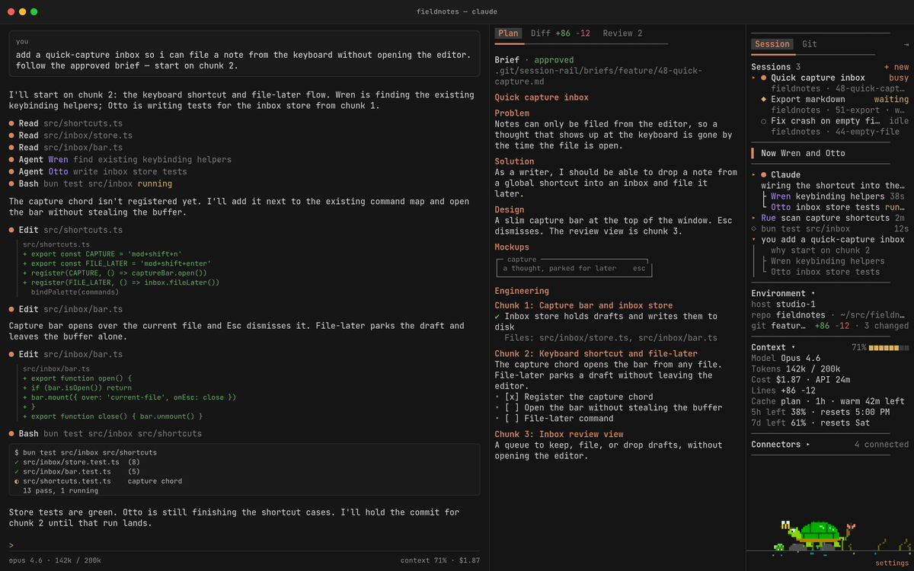
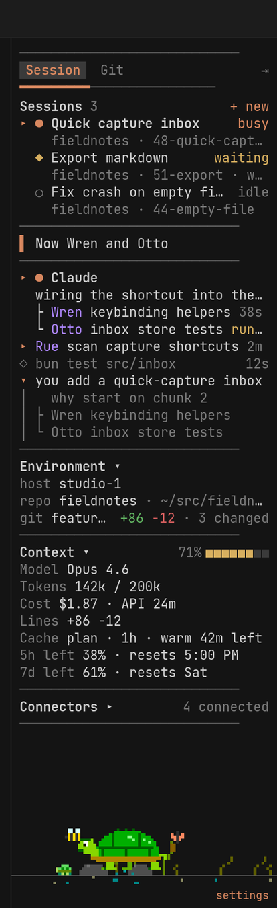
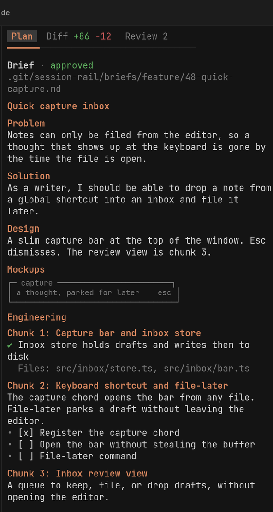
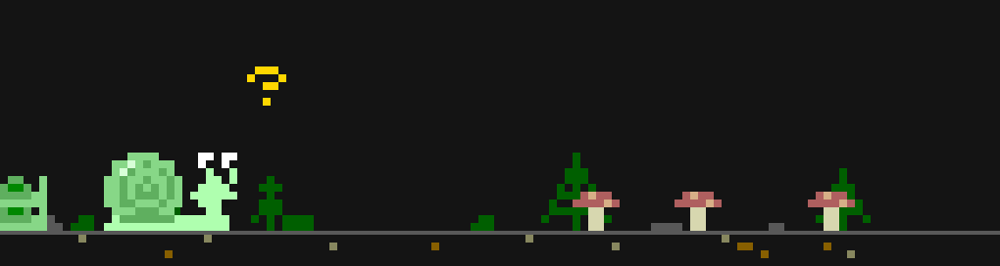

# Workbench

A visual, product-first harness for Claude Code and Grok in iTerm2.

Workbench is the desk and the rail beside the agent. Harness engineering is the work around the model: the tool loop, context and memory, permissions, done-checks, and state kept on disk, in `.git/session-rail/`, and in a worktree per session. Those controls are the panes you work in: you approve the plan, read the diff, and follow the review there.

## Why a harness

A prompt in a chat is the whole control surface. Four things slip.

| What slips | What Workbench keeps |
| --- | --- |
| Instructions drift as the thread grows | The branch brief in `.git/session-rail/briefs/`. Checkout edits wait until you approve it on the Plan tab. |
| The model can call the work done | When a test command is configured, the Stop hook runs it and blocks that stop once if it fails. The agent's `gh pr merge` waits until the saved review record is clean. |
| The window fills with no signal | The Context row shows the fill, the session cost, and the prompt cache. At a critical window the pet flashes `[!!!]`. |
| The decision stays in the transcript | Each chunk's `Done:` line and the review record live in `.git/session-rail/`. The pull request carries the commit status `session-rail/review`. |

The plugin id is `session-rail`. The panes, the files under `.git/session-rail/` and `~/.claude/session-rail/`, and that status use it.

## What you get

Each row is a harness piece and the surface you use it from. The sections after this one are the reference.

| Piece | Where you see it |
| --- | --- |
| Desk | Plan, Diff, and Review, between the agent and the rail. `/desk` toggles it. It opens on Plan. |
| Tool loop | The rail's Session tab. Now names who is working and the ask. Open an agent for the prompt it was handed and what it answered. |
| Brief | Plan. The file is `.git/session-rail/briefs/<branch>.md`, inside `.git`, so it is never committed. Approve on the tab, with `A`, or with `/approve-brief`. A newer plan file replaces the brief on that tab and has no Approve button. |
| Edit gate | Edit, Write, and NotebookEdit in the checkout wait until the brief has a problem, a solution, and at least one chunk, and you have approved it. On `main`, `master`, or a detached HEAD, create a branch first. On those checkouts, a path outside the repo is left alone. |
| Shell-write gate | A shell command that creates, overwrites, moves, or deletes a file in the checkout waits on the same gate (`bin/shellwrite.mjs`). The rail says Held. The pet holds a `?`. |
| Stop hook | When a turn ends, `bin/stop-hook.mjs` runs the project's tests. The command comes from `.git/session-rail/tests.json`, then `session-rail.json`, then `AGENTS.md`, then a real `npm test` script. A failure blocks that stop once. With no command, the stop is allowed. |
| Worktrees | **+ new** on Sessions adds a detached worktree of the default branch at `<repo>.worktrees/<name>` and opens another iTerm window. Remove is offered when the session is gone and the tree is clean, for a merged branch or a worktree that never left the default branch. |
| Approach review | The Review tab, and `review_approach`. A read-only headless pass on the brief and after each chunk. Findings are open, applied, or declined. |
| Code review | The newest `/code-review` on the Review tab, with file and line. Enter jumps to that line in the diff. Grok records `/review` the same way. |
| Wide review | Off until **Wide review** is on. On a diff of at least 8 files or 400 lines, Review offers it (`w`). Up to four file-level slices, each in a throwaway worktree, then one skeptic. Findings it keeps stay open and wait with the rest. Running it is optional. |
| Merge gate | The agent's `gh pr merge` waits until the code review has run since the last chunk review, the final approach review has run after it on the last commit with a clean tree, and nothing is open. Commits go through. A merge you run yourself goes through. |
| Pull request status | After each saved approach review and code review, the commit status `session-rail/review` and one pull request comment. `success` only when that gate is clear. `SESSION_RAIL_PUBLISH=0` posts nothing. |
| Context and cost | The Context row on the rail: the percent, an eight-segment meter, the model, tokens, session cost, prompt cache, and the account usage windows. No cost figure is `—`. The cache row is `—` under Grok. |
| Chores | Off until **Chores** is on. One chore re-checks failing CI in its own worktree. The budget counts rounds (default 5). Two empty rounds or a spent budget stops it. It does not merge. |
| Auto-compact | After the session leaves a branch whose brief has a Done chunk and whose tip is in the default branch. Claude also compacts a waiting session in the last stretch of a large prompt cache. Both switches are in the rail's settings. |
| Permissions | The starter in [docs/safe-use](docs/safe-use.md). Manual mode for Claude, ask mode for Grok, the Bash sandbox on, auto-allow off. A starting point, not a guarantee. Workbench runs on your Mac. |
| AGENTS.md | The host project's map. A fence tagged `test` is the command the Stop hook runs when nothing else names one. |
| Pet | The creature at the bottom of the rail. `[!!!]` for a critical context window, a held `?` while the brief blocks edits, a building mood as the window fills, and a body that grows as chunks are marked Done. |

## The panes

Starting `claude` or `grok` in iTerm2 opens the desk and the rail on the right. `/rail` and `/desk` hide a pane or bring it back. If you have a `/start` command of your own, it runs as soon as the session starts.



The picture is a mock. The session text and the numbers are made up.

```
┌─ claude ──────────────────────────┬─ rail ───────────────────────────┐
│                                   │ ──────────────────────────────── │
│                                   │  Session   Git                 ⇥ │
│                                   │ ━━━━━━━━━─────────────────────── │
│                                   │ Sessions 3                 + new │
│                                   │ ▸ ◉ Fix login redirect loop busy │
│                                   │     my-app · fix/42 · Edit redi… │
│                                   │   ◆ Dark mode toggle     waiting │
│                                   │     my-app · feature/51 · waiti… │
│                                   │ ──────────────────────────────── │
│                                   │ ▌ Now  Wren · find the callers   │
│  > fix the login redirect         │ ▸ ● Claude                       │
│                                   │   the redirect drops the query   │
│  ● Reading src/auth/login.ts      │   └ Wren                     38s │
│  ● Editing src/auth/redirect.ts   │ ▾ you  fix the login redirect    │
│                                   │ │   why  the redirect drops it   │
│                                   │ │ ├ Wren  find the callers       │
│                                   │ ──────────────────────────────── │
│                                   │ Environment ▾                    │
│                                   │ Context ▾          33% ▰▰▰▱▱▱▱▱  │
│                                   │   Model    Opus 4.6              │
│                                   │   Tokens   66k / 200k            │
│                                   │   Cost     $0.55                 │
│                                   │   Cache    plan · 1h · warm 42m  │
│                                   │ ──────────────────────────────── │
│                                   │ Connectors ▸         4 connected │
│  >                                │                                  │
└───────────────────────────────────┴──────────────────────────────────┘
```

## What it shows

The rail has two tabs: **Session**, how this session is thinking, and **Git**, where the work stands. `Tab` or `]` goes to the next tab, `Shift-Tab` or `[` to the previous one, or click one. Each rail remembers its own tab.

### Session

```
 ▌ Now  Wren and Otto
 ────────────────────────────────────────
 ▸ ● Grok
   the tab now opens each handoff
   ├ Wren    how the session tab is drawn
   │    asked   how the session tab is drawn
   │    prompt  Read the session tab and say what a person can learn
   │    said    It lists tool calls. The ask itself is missing.
   └ Otto    run the tests                 running
 ▸ Rue     read the pet stages            2h
 ◇ bun test                               12s
 ▾ you   bring that attitude to the session tab
 │   why  I'll look at the session tab first
 │ ├ Wren  how the session tab is drawn
 │ └ Otto  run the tests
 ▸ you   the pet should follow the session
```



The banner is the only status. `Now` names who is working and the ask they were given. Two people read `Wren and Otto`. `Held` means the brief just stopped an edit. `waiting for you` means the turn has ended. A tool with no handoff names the file, as in `reading rail.mjs`. That sentence is not repeated on the row below.

Under it is this second. Grok or Claude is the root, with no second status beside the name. The latest reply sits under the name, and Enter opens the whole text. Each subagent hangs under the one that asked it. Names are purple. The lamp is how long the agent has been going, or `running` while a shell is in flight. When one agent is working, the banner already has the ask, so the row is the name and the lamp. With several, each row keeps its ask. A background agent sits level with Grok or Claude, and is left out of the banner while someone in the foreground is named. A shell still running is a `◇` on its own row, and Enter opens its output. The desk's review is a row while it runs.

Open an agent. `asked` is the one line it was given. `prompt` is the handoff itself, the words that were sent. `said` is what came back. `doing` is the call in flight. Enter on `prompt` or `said` opens the whole text. Nothing here is inferred.

A subagent that has finished stays on its own row under the live ones: the name, the task it was given, and how long ago it finished. Newest first. Enter opens the prompt and what it answered. The list is every subagent this session spun up.

Under that, each thing you typed is a chapter, newest first. Open it for what the agent said it was going to do (`why`), the agents that turn handed work to, and what it answered. The reply already under Now is not printed again. `⟲ compacted after <branch>` stays for an hour after a boundary compact. A warm compact reads `⟲ compacted before the cache went cold`.

The words come from the session. The hook keeps the prompt, the reply, and your turns in the activity file as they happen. The rail also reads the transcript: Grok's `chat_history.jsonl` and `subagents/<id>/meta.json`, and Claude's session log. A subagent's prompt is the `prompt` it was spawned with. Its reply is what it returned.

- **Sessions:** every session on your Mac, this one first (▸), then the ones that need you. Each shows its brief's title (or its branch), whether it's busy, waiting for you, blocked (the brief gate just held an edit) or idle, and underneath, its repo, branch, and what it's doing right now. Every rail shows the same list.
- **Environment:** your computer, account, repo, and branch, labeled host, repo, and git, with the lines added and removed since the branch forked from the default branch (committed plus uncommitted; untracked files are not counted). The account and Remote Control stay on dim rows under those three.
- **Context:** how full the context window is. It starts open. The meter is eight segments: blue under 50%, yellow from 50%, red from 80%. Under it: the model, the token count, the session cost, the prompt cache, and the usage windows (5h, 7d, week, month, as time left). While the brief is holding edits, or the window is stomping, bulking, or showing `[!!!]`, one dim line sits under the meter: `brief waiting for approval`, `context is filling up`, or `context 85%, compact or wrap up?`.
- **Cost:** this session's spend, in US dollars, when the host reports a figure. Claude's number is its session ledger (the same dollars as `/usage` and the status line). It starts over when `/clear` starts a new session. The 5-hour and 7-day plan windows stay percentages on the rows under it. The row prints the dollars, as in `$1.87 · API 24m`. A later reading adds the rise since the one before, as `turn`. Grok's number is the session total in that session's usage file (`costUsdTicks`, 10¹⁰ per dollar), with this turn beside it when that turn recorded a cost. A host with no figure shows `—`. Tokens stay on their own row.
- **Cache:** whether this session is on a plan or an API key, its prompt cache's lifetime (1 hour on a plan, 5 minutes on an API key), and the time left, for example `plan · 1h · warm 42m left` or `API · 5m · cold 12m`. Each main-loop request renews it. It shows `—` before the first request and under Grok.
- **Connectors:** your MCP servers and whether they're connected.

### Git

```
 my-app · main                       ↻ 4s
 ▌ Next  merge #35 · rebase #36
 ────────────────────────────────────────
 │ main
 ┣▸ ● feature/35-branch-map    ↑4↓1 #35 ✓
 │ └▸ feature/36-colours         ↑2 #36 ◌
 ┣▸ feature/40-pets                 #40 ✗
 └▸ feature/41-api        not checked out
```

Enter on a branch opens it in place, and Enter again closes it. The lane stays, and so does the branch stacked on it:

```
 ┣▾ ● feature/35-branch-map    ↑4↓1 #35 ✓
 │┃   +42 −7 · 3 uncommitted
 │┃   clash  rail.mjs
 │┃   ✗ lint                      failing
 │┃   ✓ test
 │┃   Go to session
 │┃   Open PR #35
 │┃   Copy branch name
 │┃└▸ feature/36-colours         ↑2 #36 ◌
```

One tree of the branches still open. A branch hangs under the branch it would rebase onto: its pull request's base, otherwise the nearest other open branch whose tip is an ancestor of it, otherwise the default branch. The default branch is the dim trunk. A pull request with no checkout is still there, marked `not checked out`. A detached checkout is one dim line.

The banner is the only sentence. `Next` is the trunk pull request whose checks pass and whose merge is clean, then the child that rebases once it lands. `Held` is that same pull request when GitHub calls it dirty, when it shares a changed file with a branch that is not its parent or its child, or when merging it into its parent conflicts. A child that keeps editing the parent's files is the stack, so the line stays `Next`. A clean merge does not clear the shared-file list. A child does not take the line while its parent is still open. The picture never merges a parent into a child, and it never runs the rebase.

A collapsed branch is one line. Names share a column. `↑` is how far it is ahead of its parent and `↓` how far behind, then the pull request number, then one lamp: `✓` passing, `✗` failing or conflicting, `◌` draft or running. The lane itself carries the colour: green for the branch `Next` names, yellow for a shared file, red for a failed check or a real conflict. This checkout's `●` and name stay the accent.

Open a branch for this checkout's `+N −N` and uncommitted count, the clashing files, the conflicting files, the checks (failing first), and the actions: go to that checkout's session, open the pull request, copy the branch name. When a review asked for changes, that row is yellow and the first line of the review is under the checks. That line comes from one `gh pr view` the moment the lane opens. Enter on a check opens it. Enter on an action runs it.

The tree refreshes about once a minute, when you switch to Git, on `r`, and again when the branch changes. `+N −N` and the uncommitted count come from this checkout every 5 seconds. Checks come from GitHub through `gh`. Only your own open pull requests are listed, up to 100. When that list cannot be fetched, the last one stays and the tab says GitHub is unavailable.

Click a row, or use the arrow keys and Enter, to open it. On Session, Enter expands an agent or a chapter, and Enter on a prompt or a reply opens the text. On Git, Enter expands a branch in place. A session jumps to its iTerm window (a session in the Claude app gives you its details instead), pull requests and checks open in the browser, and tasks show their output.

### Working on several things at once

**+ new**, on the Sessions heading, starts another session in its own checkout. Type the problem on the rail's bottom line and press Enter (Esc cancels). The rail fetches, adds a detached git worktree of the default branch beside the repo in `<repo>.worktrees/<name>`, opens a new iTerm window there at the same size and place as this one, and runs this rail's agent with `/start <your problem>` (`claude` or `grok`). `/start` files the issue and makes the branch inside that worktree. Each window gets its own agent │ desk │ rail. With one tab per window iTerm shows no tab bar: the Sessions list is how you move between them.

When that session is gone and the branch is merged, or the worktree never left the default branch, Sessions and Git both offer to remove it. Enter, then Remove: one confirm runs `git worktree remove`. A dirty worktree is listed in that menu and left where it is. Unmerged work is not offered, and the checkout you are in is never removed. After the session compacts itself off a merged branch, the rail offers that worktree too, for an hour, when it is still there and safe to remove.

## A scheduled chore

One chore, off until you turn it on. It re-checks failing CI for the branch you have open. `/loop` stays inside one session.

Turn it on with **↻ Chores** in the rail's settings (`"chores": true` in `~/.claude/session-rail/settings.json`). Then either press **↻ Re-run failing CI** under Sessions, or run the schedule path from the repo:

```
node bin/chore-run.mjs start --budget 5
node bin/chore-run.mjs round --dry-run --failing lint
node bin/chore-run.mjs round --dry-run --failing test
node bin/chore-run.mjs round --dry-run --failing typecheck
node bin/chore-run.mjs show
```

`/schedule` is that same path. The command file tells the session to run it and to stop there.

What you get:

- Its own worktree, detached, beside the repo in `<repo>.worktrees/chore-<id>`. On a Mac where iTerm is already running it also opens its own window. It never launches iTerm itself.
- A budget counted in rounds. The default cap is 5, and the cap has to be from 1 to 100. Each round costs one, whether or not it found work. Session cost on the rail is a separate figure.
- A state file at `.git/session-rail/chores/<id>.json`. The first field is a short summary: what was tried, which rounds were empty, the spend, and that a person reviews before anything merges.
- A stop after two empty rounds (nothing failing, no checks, or no pull request) or when the budget is spent. The next round is refused and the spend does not move.
- A row on Sessions: busy while a round runs, waiting when it is your turn to review, blocked when it has stopped itself.

The brief gate and the review cadence still apply. The chore does not edit the repo, does not approve the brief, and does not run `gh pr merge`. You merge, after the reviews you already require.

The three dry runs above spend 3 of 5. The state file is what you read. A live round (leave off `--dry-run`) asks `gh pr view` for the pull request's checks. Green, or no pull request, is an empty round.

**Leave it off** when any of these is true:

- The machine would be unattended. This includes overnight on the host Mac, a standing auto-approve, and any runner that merges while you are away. The chore does not sandbox the Mac and it does not approve anything for you.
- You do not want a budget. There is no way to run it without a round cap.
- There is no signal. With no checks and no tests, every round is empty and it stops after two.

Details and the empty-round example are in [docs/chores.md](docs/chores.md).

## The desk

```
┌─ desk ───────────────────────────────────────────────────────────────────────┐
│  Plan   Diff +134 −6   Review 2                                              │
│ ──────────────────────────────────────────────────────────────────────────── │
│ 4 files since the branch forked  +134 −6                                     │
│                                                                              │
│ Chunk 1: Show the date and time in the header                       +95 −2   │
│ ✔ Added date and time state, pulled from the clock API once a minute         │
│       src/header.tsx                                                 +58 −2  │
│   new src/useClock.ts                                                +37 −0  │
│                                                                              │
│ Not in a chunk yet                                                  +39 −4   │
│       README.md                                                       +2 −2  │
└──────────────────────────────────────────────────────────────────────────────┘
```

- **Plan:** the plan, live. That is the branch's brief, with an **Approve** button when it's ready, unless the session's plan file is newer, in which case that file is the body and has no button. A change of either one selects Plan and scrolls to the top. With nothing written, the tab says so (on `main`, create a branch; on a feature branch, the brief is not written yet), then lists the **Todo** issues and recent work.
- **Diff:** every file changed since the branch forked from the default branch, the same base as the rail's `+N −N`, grouped under the brief's chunks with each chunk's summary. Untracked files are included, marked `new`. Open a file to see its diff.
- **Review:** the branch's reviews and what became of each finding.
  - **Approach:** a staff-engineer review in a separate headless process. It reads the brief, each chunk's summary and files, and how much each file changed. It says whether this is the simplest, most elegant and least costly way to the goal: on track, a simpler path exists, or off the goal. Findings are a simpler design, work beyond the goal, avoidable cost, or part of the goal not covered. Claude's run is `dontAsk` with Read, Grep, Glob, and `Bash(git *)`. Grok's run uses `--always-approve` with only `read_file`, `grep`, and `list_dir` left on; write, shell, and web tools are removed.
  - **Code review:** the newest `/code-review`, finding by finding, with its file and line. `Enter` jumps to that line in the diff.
  - Each finding shows ● open, ✓ applied or ✗ declined (✓ fixed, ✓ no change or ✓ skipped for code), and a declined one shows the reason. Older runs are listed one line each. Reviews are saved per branch in `.git/session-rail/reviews/`.

The desk opens on Plan. A change of the plan selects Plan again.

### The session brief

On any branch but `main` or `master`, and not on a detached HEAD, the session keeps a brief: what it sets out to do, and what the work is checked against at the end. It lives at `.git/session-rail/briefs/<branch>.md`, so it is never committed. On `main`, `master`, or a detached HEAD there is no brief. The agent is told to create a branch first, and an edit of a file in the repo, including a shell command that writes one, is refused until that branch has a brief you have approved. On those checkouts, a path outside the repo is left alone.

The desk reads the folder the session was started in. A session started in a parent of this repo is not in a repo, so its Plan tab has no brief, and a brief written here does not show on that desk. The agent says the plan is in the Plan tab only after rendering this session's desk and seeing the brief there.

```
# <title>

## Problem       Currently it's A; we need B to solve A
## Solution      As an X, I should be able to Y so I can Z
## Design        UI/UX decisions
## Mockups       ASCII mockups
## Engineering
### Chunk 1: <name>
<outline>
Done: <summary>             ← added as each chunk is finished
Files: src/a.ts, src/b.ts
```



- As you talk the problem through, the agent says when it's scoped out and writes the brief. You don't need to ask. It tells you the plan is in the Plan tab only after rendering this session's desk and seeing the brief there. The brief file itself can still be written before approval. Its approval file cannot. The agent never approves the brief.
- Edits wait until the brief has a problem, a solution, and at least one chunk, and you've pressed **Approve** (or `A`, or `/approve-brief` when the desk isn't open). That covers Edit, Write, and NotebookEdit, and a shell command that would create, overwrite, move, or delete a file in the checkout (`cat >`, `tee`, `cp`, `mv`, `rm`, `sed -i`, `git checkout --`, `git apply`, and the like). `git log`, `git status`, and the tests still run. A command whose path is not a literal is treated as a write, so you run it yourself. The refusal is the Held banner, and the pet's `?`. See [Safe use](#safe-use).

  
- Approving writes the approval file. Within a couple of seconds, once the agent is idle, Claude is sent a message to start on chunk 1, and Grok has the same line typed into the session.
- Once approved, the edit gate stays open, including after the brief changes. If the problem, solution, or outline changes, the Plan tab says `approved · changed since` and offers **Approve again**, which tells the agent the change is approved so it carries on. Adding `Done:` and `Files:` lines does not count as a change.
- Both hosts are told to work the chunks in order. For each chunk: check it against the plan and run the tests, add `Done:` and `Files:`, run the approach review and apply its findings (at most two rounds), run what the chunk built once for real, commit that chunk, and push, opening the pull request after the first chunk. Then the next chunk, unless something needs your decision.
- When the session leaves a branch whose brief has a Done chunk and whose tip is in the default branch (`origin/HEAD`, `main`, or `master`), the session compacts itself after the turn ends. The summary keeps the board, how you like work done, open issues, and what's next, and shrinks the finished branch to a line. Leaving an unmerged branch does not compact. Turn it off with **Auto-compact** in the rail's settings (`autoCompact` in `settings.json`; on unless set false). Grok gets `/compact` typed in; Claude compacts through the host. Up to three tries. If that branch still has a clean **+ new** worktree and no session is using it, the rail then offers to remove the worktree.
- Before a waiting Claude session's prompt cache goes cold, and only while the cache still holds at least 50k tokens, the session compacts itself. The window is the cache's last stretch: the last 10 minutes of a plan's hour, the last minute of an API key's 5 minutes, and it stops 15 seconds before expiry. A cache that is already cold is left. It tries at most three times per request. The summary keeps the task in hand, the files, the test command, and the next step. Turn it off with **Before cache cold** (`warmCompact` in `settings.json`; on unless set false). Claude only. The rail hides that row under Grok. On an API key you can choose the 1-hour cache (`"promptCacheTtl": "1h"` in Claude's settings, or `CLAUDE_CODE_PROMPT_CACHE_TTL=1h`).
- The agent is told to run an approach review on the plan and on every chunk, and a code review of the whole branch before a merge.

Keys:

| Key | Does |
| --- | --- |
| `Tab` / `Shift-Tab`, `1` `2` `3`, or click | switch tabs |
| `↑` `↓`, `j` `k`, mouse wheel | move or scroll |
| `Space` / `b`, `PgDn` / `PgUp`, `g` / `G` | page, top, bottom |
| `Enter` | open a file (Diff) |
| `n` `p`, `Esc` | next/previous file, back to the list |
| `A` | approve the brief (Plan) |
| `r` | run a review (Review), refresh (other tabs) |
| `w` | wide review, when the diff is wide and Wide review is on (Review) |
| `Enter` | jump to a code finding's line (Review) |
| `x` | cancel a running review |
| `q` | close the desk |

An approach review is a separate headless run: `claude -p` on Claude, `grok -p` on Grok, with the tools above.

### Reviews

Two reviews, each where it pays off, plus an optional third:

- **The approach review** (`review_approach` on Claude, `node bin/reviewer.mjs --run` on Grok; the desk's Run review calls the same reviewer) runs often:
  - **On the plan:** once the brief is complete, before you're asked to approve it.
  - **After each chunk:** once its `Done:` line is in. The agent applies each finding and calls the tool once more to check them, at most two rounds. Each review marks the earlier findings **applied**, **declined** (with a reason), or still **open**.
  - Then the agent is told to run what the chunk built once for real, before committing.
- **The code review** is what the agent is told to run once the person says to merge, over the whole branch: `/code-review --fix` on Claude, `/review` or `/code-review` on Grok. Its fixes are committed. Then `review_approach` with `final: true` checks that claimed fixes landed, and accepts each skip or "no change" or reopens it. The agent applies what it finds, commits, and calls it once more to check, at most two rounds. Anything still open after that is listed in the PR, and the agent asks you instead of looping.
  - Claude notices the Skill tool running `/code-review`, or you typing it, gives the run a token, and asks it to end with its findings as a JSON block that carries the token. The answer that carries the token is the report, forked or inline. Grok arms the same record when you type `/review` or `/code-review`, and records the final message's JSON findings block.
- **Wide review** is off unless **Wide review** is on. On a diff of at least 8 files or 400 lines, the Review tab offers **Wide review** (`w`). It splits the diff into at most four slices, reviews each in a throwaway worktree with a short file-level pass, and runs one skeptic that can decline a finding. What the skeptic keeps stays open in that one report. What it drops is declined. A later approach review can mark a kept finding applied. The file reviewers and the skeptic show on the rail as named subagents, with a visitor each, while they run. The approach review and `/code-review` keep their own cadence. A merge waits on a wide review only for open findings the newest one kept. `node bin/widereview.mjs` runs it from the shell. Set `wideModel` in `settings.json` to send those calls to a smaller model.
- **The gate:** the plugin refuses the agent's `gh pr merge` until the code review has run since the last chunk's review, the final approach review has run after it on the last commit with nothing uncommitted, and nothing is open, including open findings from the newest wide review. The agent is told what's missing. Commits are not gated. You can merge the pull request yourself, and `git merge` still runs.
- **On the pull request:** after each approach review and each code review, the plugin posts a commit status named `session-rail/review` on that commit, and updates one comment on the pull request. `success` is posted only when the gate above is clear. Open findings, a missing code review, or a final review that has not run are `failure`. The plugin does not post `success` from a review's prose, and it does not post a status you did not record. Do not post `session-rail/review` yourself. Set `SESSION_RAIL_PUBLISH=0` to leave the record only in `.git`. `node bin/publish.mjs --require` exits 1 unless that status is already success.
- GitHub still allows the merge until you add `session-rail/review` as a required status check (Settings → Rules → Rulesets, or the branch protection rule). The context shows up in the list after it has been posted once; you can type the name. That rule is off until you add it.
- To also fail a pull request that has no status at all, copy `docs/session-rail-review.yml` to `.github/workflows/session-rail-review.yml`. The workflow only reads the status. It fails when `session-rail/review` is missing or not `success`, and it does not create a passing status. It does not run until that copy is in `.github/workflows`. Mark the workflow required as well if a missing status should block the merge. Until you do, it only reports.
- The desk's Review tab says when the pull request is already merged, or when GitHub will let a person merge it while the record is not clean.
- **The PR's Progress checklist** is part of the procedure the agent is given: each chunk notes its approach review. The status and the comment are the record a teammate can see without this Mac's `.git` directory.

The gate covers commands the agent runs. A `/code-review` you type yourself counts too. **Run review** in the desk runs an approach review on demand. A desk run is marked manual, so it does not make the code review stale.

## Tests before a stop

When a turn ends, a Stop hook can run the project's tests and send the agent back if they fail. The same rules run for Claude and for Grok. Nothing is run, and the stop is allowed, when no test command is configured, so a folder with no tests is never blocked.

The command is chosen in this order:

1. This checkout, `.git/session-rail/tests.json`: `{ "command": "npm test" }`, or `{ "command": false }` to turn the gate off here without changing the project.
2. `session-rail.json` at the repo root: `{ "testCommand": "npm test" }`, or `{ "testCommand": false }` to turn the gate off for the project.
3. A command named in the host project's `AGENTS.md`, the git toplevel of the session. The hook uses the first fence tagged `test` (one command per line, joined with `&&`), otherwise a line such as `Tests: npm test` or `- Run tests: \`npm test\``, otherwise the first command under a heading named Tests. It takes a command only from those shapes, so a file that only discusses tests leaves the stop alone.
4. `npm test`, when `package.json` has a real `scripts.test`. npm's placeholder (`no test specified`) does not count.
5. In this Workbench repo only, when nothing above names a command: `claude plugin test .` and the frame checks. This repo's `AGENTS.md` names a command, so the hook runs that fence, which starts with `claude plugin validate .`.

A failing command blocks the stop once. Claude's hook exits 2 and the reason on stderr is what Claude is told. Grok gets the same reason as a block decision and exits 0, which is how its hooks report a block. The reason includes the tail of the test output. If this stop is already a continuation (`stop_hook_active`), the hook exits 0 and does not block again, so it cannot loop. A turn the person interrupted is left alone.

The rail shows one line, `tests failed`, and the pet flinches and droops the way it does when a tool fails. A later pass clears both. There is no separate mark for the gate.

Turn the gate off with `"testCommand": false` in `session-rail.json`, or `"command": false` in `.git/session-rail/tests.json` for this checkout only.

A host project can keep the same kind of map. A fresh session reads `AGENTS.md` for how to test. A short file is enough, and the `test` fence is the command the Stop hook runs:

````markdown
# AGENTS.md

## Tests

```test
npm test
```
````

Point the rest at the project's longer docs.

## What you need

- A Mac with iTerm2
- Claude Code 2.1.319 or newer
- Node.js 18 or newer
- The GitHub CLI (`gh`), for the pull request list and for posting the review status (optional; without it the record stays in `.git`)

## Install

In Claude Code, run:

```
/plugin install session-rail --marketplace sarmilan/workbench
```

Say `y` to add the marketplace. Start a new `claude` session in iTerm2 and the desk and the rail open on the right.

The same plugin does this for Grok. In a terminal:

```
grok plugin marketplace add <this folder>
grok plugin install <this folder> --trust
```

Start a new `grok` in iTerm2. The desk and the rail open on the right, and the brief, the reviews, and **+ new** work the same way. Plan shows the branch brief, and a newer `plan.md` (the file plan mode writes) replaces it until the brief catches up. A change of either one selects Plan. Claude's plan file works the same way. The pet follows the activity feed, since a Grok session file never says busy. `/rail` and `/desk` are in the slash menu, and the two panels use Grok's colours. A session that is already open does not pick the plugin up until you start another one. The install copies this folder; refresh it with `grok plugin uninstall session-rail --confirm`, then the install again.

If macOS asks whether to allow controlling iTerm2, allow it. That's how the panels open their panes and how the rail switches between sessions.

## Use

- The rail and the desk open by themselves when you start `claude` or `grok`.
- `/rail` hides or shows the rail, and `/desk` the desk.
- They close when you quit the agent.
- Keys: `↑` `↓` to move, `Enter` to open, `Esc` to go back, `c` to change creature, `q` to close the rail.
- **settings**, in the rail's bottom-right corner, opens the rows under the creature. `←` `→` on **Font size** makes the agent pane, the desk, and the rail bigger or smaller together (`Enter` for Reset). `←` `→` on **Pet** picks the creature. `←` `→` on **Auto-compact** turns compaction after a merged branch off or on. `←` `→` on **Wide review** turns the optional wide-diff review off or on (off unless you turn it on). `←` `→` on **Before cache cold** does the same for the warm compact (hidden under Grok). `←` `→` on **Chores** turns the CI chore on or off. It ships off. The font size is remembered. It works by switching the panes to iTerm profiles the plugin generates (`session-rail 15pt` and so on), which show up in iTerm's Profiles menu.
- A pixel creature wanders along the bottom: a snail, a turtle (green shell, amber when heavy), or a crab. It walks through its habitat (woodland, a pond, or a beach) on speckled ground, with plants swaying in iTerm2. Sand puffs under the crab, and the reeds bend when the turtle hops. It hurries while the agent is busy, looks left and fidgets while it is waiting for you, and falls asleep only after a real lull. Your pick is remembered. The full reading is in [docs/pets.md](docs/pets.md).
- The strip is the branch's road, left to right. The creature paces around a spot that moves right as the brief's chunks get Done, from the left edge before approval to the right edge when all of them are. Each Done chunk leaves a marker (a mushroom, a lily pad, or a shell) and the creature hops with a gold sparkle. With no brief, that spot is how full the context window is. Until the window's size is known, it wanders the whole strip.
- Each running subagent brings a visitor: a bee, butterfly, dragonfly, or ladybird, tinted with that subagent's colour (up to 4, and a `+n` when more are running). They flutter around the creature, settle when things are quiet, scatter when a tool fails, and fly off when their subagent finishes.
- A baby of the creature trails behind it for each running background command (up to 3, then a `+n`). Babies tuck in when it sleeps, pile up while the brief is unapproved, and hide behind it when it flinches. A failed tool makes it flinch, pop a red puff, and stay drooped until the next tool succeeds. A failed Stop-hook test is the same flinch. The brief gate does not flinch: it stands still with a yellow `?`.
- **Held.** While the brief exists and is not approved, the pet stands still with a yellow `?`. For the first 8 seconds the mark bobs. From 8 to 12 seconds it grows to twice that size. After 12 seconds it holds that size and dims. Approving it, including an approval kept after an edit, lets it walk. Waiting for you, with the brief already approved, does not show a `?`.
- **Building.** Context is its own channel, on whatever stage the brief chose. Under 50% the walk is ordinary. From 50% it wears a brow (off again below 45%). From 80% it stomps. From 85% the body bulks, without the gold ready mark.
- **`[!!!]`.** The window is in the critical band: on at 85%, off below 80%. This is separate from the gold mark. The text fallback draws `[!]` when the strip is wide enough.
- **Growing.** A hatchling until the brief is approved, a juvenile once it is, an adult after the first Done chunk (faster, hopping), and heavy once every chunk is Done (bigger, shaking, a gold mark: merge it and let it compact). With no brief, the same drawings follow the window: a hatchling under 5%, a juvenile under 20%, and an adult from there. Heavy stays off, and a full window does not put the gold mark on. After a compaction the window drops and the pet shrinks. A stage-up pops a short ring of sparks. The same four drawings exist for the snail, the turtle, and the crab.

## How it works

The rail reads files the agent already keeps on your Mac: the list of running sessions, the session's conversation log, each subagent's prompt and reply, and the output of each background task. Claude's session cost is the ledger the plugin records from `session.measure` into the activity file. Grok's is read from the session's usage file. It also asks `git` (worktrees, ahead/behind, commits) and `gh` (your pull requests and their checks, in one call). Connectors come from `claude mcp list`, or under Grok from `grok mcp list` plus the account catalog, the linked X account, and whether `gh` is logged in.

1. **The rail** (`bin/rail.mjs`) draws the narrow panel. Plain Node, no dependencies. `bin/sessionstory.mjs` turns the activity feed and the transcript into the Session tab's tree.
2. **The desk** (`bin/desk.mjs`) draws the wider panel. It reads the brief (`bin/brief.mjs`), finds the plan file in the session log, asks `git` for the diff, and asks `gh` for the board's Todo issues. `bin/reviewer.mjs` runs the approach review through `claude -p` or headless `grok`, with a JSON schema, read-only tools, and no saved session, and keeps each branch's reviews in `.git/session-rail/reviews/`. The same reviewer is `node bin/reviewer.mjs --run [--final] [--notes …]`, which `review_approach` calls. `bin/cadence.mjs` holds finding statuses and `gateReason`, which says why a merge must wait. Wide review is `bin/wide.mjs` and `bin/widereview.mjs`.
3. **The pane opener** (`bin/pane.mjs`) uses iTerm2's AppleScript support to fill the screen, split the agent's pane, run each panel, size them, and hand focus back. It never launches iTerm2, and it stops at the nearest `grok` or `claude` process. A headless run with no TTY owns no pane. The rail uses it to bring another session's window to the front and to open the window for a new session.
4. **The plugin** (`hooks/register.ts` for Claude, `bin/grok-hook.mjs` for Grok) writes `~/.claude/session-rail/activity/<session id>.json`: turns, tool calls, the prompt cache (`bin/cache.mjs`), the session cost (`bin/cost.mjs`), subagents and the names given at spawn, and the brief gate. The rail reads it every second. The desk writes `<session id>.desk.json` beside it. Claude opens both panels on session start, adds `/rail`, `/desk`, and `/approve-brief`, and closes them on session end. On a feature branch it adds the brief to the system prompt, refuses repo edits and shell writes until the brief is approved (`bin/shellwrite.mjs`), watches for the approval (`hooks/goahead.ts`), and compacts after a finished merged branch and before a waiting cache goes cold (`hooks/compact.ts`). Grok attaches the same brief procedure on the first tool call of each turn. `bin/grok-watch.mjs` types the go-ahead, `/compact`, and `/start`, which a hook cannot do itself. Both hosts refuse `gh pr merge` until `gateReason` is clear, and `bin/stop-hook.mjs` runs the test gate (`bin/stopgate.mjs`). Settings live in `~/.claude/session-rail/settings.json`. Each rail keeps its tab in `<session id>.rail.json`.

## Safe use

Workbench runs on your Mac. It is not a container. The plugin can split iTerm2, focus a session, open a window, and type a line into a pane (`bin/pane.mjs`). Those calls run as you. Claude Code's Bash sandbox and Grok's sandbox profile do not wrap them, and they do not wrap file tools, MCP servers, or plugin hooks. A session can read and write what you approve, including files outside the repo. [OpenHands](https://docs.openhands.dev/openhands/usage/sandboxes/overview) runs the agent in a Docker sandbox by default. This plugin does not. An unattended loop wants a disposable machine and credentials that are not your real ones.

Start Claude in Manual mode, without `--dangerously-skip-permissions`. Start Grok in ask mode, without `--always-approve`. Approve a brief for a checkout you mean the agent to edit. The sample in [docs/safe-use](docs/safe-use.md) is a starting point, not a guarantee. Merge [`claude.settings.json`](docs/safe-use/claude.settings.json) into `~/.claude/settings.json`, and the Grok files on that page into `~/.grok/`. It keeps Manual mode, asks before `git push` and `gh pr merge`, denies a few destructive and credential paths, and turns the Bash sandbox on with auto-allow left off. Workbench does not change your permission mode.

A Bash deny matches the command text. `Bash(curl *)` does not stop `/usr/bin/curl` or `sh -c 'curl …'`. The sandbox is the operating-system boundary for shell commands. File tools follow permission rules, outside that sandbox.

When you choose "Yes, and don't ask again" for a Bash command or a WebFetch domain, Claude Code saves the allow rule to `.claude/settings.local.json` at the main checkout, including from a worktree. **+ new** worktrees share that file.

The brief gate covers Edit, Write, and NotebookEdit, and a shell command that creates, overwrites, moves, or deletes a file in the checkout (`bin/shellwrite.mjs`). `git log`, tests, and commits still run. `gh pr merge` stays on the review gate.

- [Configure permissions](https://code.claude.com/docs/en/permissions)
- [Configure the sandboxed Bash tool](https://code.claude.com/docs/en/sandboxing)
- [Grok permissions](https://docs.x.ai/build/features/permissions)
- [Grok sandbox](https://docs.x.ai/build/features/sandbox)

## Good to know

- It works in iTerm2 on a Mac. Elsewhere the plugin stays quiet.
- When a session starts, the iTerm window fills the screen (without switching to macOS full screen). The desk takes 28% of the width, the rail 18.5%, and the agent keeps the rest. `/rail` and `/desk` take their share from the agent's pane, and the window never grows.
- A second Claude login (`CLAUDE_CONFIG_DIR=~/.claude-work claude`, or any `~/.claude-<name>`) works too: the rail lists its sessions and reads its context, plan, background tasks, account, and rate limits from that dir. The panes, the pet, and the settings stay shared.
- Context shows tokens, the model, and the session cost when the host reports one. No figure is `—`.
- It reads Claude Code's own files, which can change between Claude Code versions.
- A **+ new** worktree whose branch is merged, that is clean, and whose session is gone, can be removed from Sessions or Git. A detached worktree that never left the default branch can be removed on the same terms. Dirty worktrees are listed there and kept. Unmerged work is kept. Claude keeps a separate project memory for each worktree, and that folder goes away with the worktree.
- The rail deletes activity, desk, and tab files in `~/.claude/session-rail/activity/` once that session's process is gone. A live session's files stay. A file written in the last minute stays too. Ending the session deletes its own files; `/clear` keeps them. The pet hops once when a worktree is removed.

## Uninstall

```
claude plugin uninstall session-rail
```

## License

MIT
